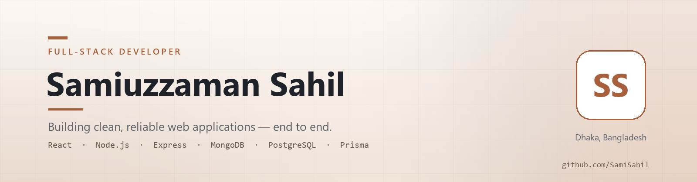

<picture>
  <source media="(prefers-color-scheme: dark)" srcset="assets/banner-dark.png">
  <source media="(prefers-color-scheme: light)" srcset="assets/banner-light.png">
  
</picture>

<h1 align="center">Hi, I'm Samiuzzaman Sahil</h1>

  <b>Full-Stack Developer</b> — I build clean, reliable web applications from database to interface. 
  Computer Science & Engineering student at Uttara University · Dhaka, Bangladesh

  
  
  

---

## About Me

I'm a Computer Science & Engineering student at **Uttara University** and a **full-stack developer** who enjoys turning ideas into working products. I build responsive interfaces with React and Tailwind CSS, and back them with APIs using Node.js, Express and databases like MongoDB and PostgreSQL.

I care about readable code, thoughtful UI and shipping features that solve real problems. I'm currently looking for an **internship or junior full-stack role** where I can contribute to a real product and keep growing as an engineer.

---

## Currently

- **Studying** — B.Sc. in Computer Science & Engineering at Uttara University (2023 – present)
- **Building** — full-stack applications with React, Node.js and PostgreSQL
- **Going deeper** — Docker, Prisma and software architecture
- **Open to** — internship and junior full-stack opportunities

---

## Tech Stack

| Layer | Technologies |
| :--- | :--- |
| **Frontend** |        |
| **Backend** |       |
| **Tools** |       |

---

## Featured Projects

### EduSysPro — School Management System

A full-stack platform that streamlines daily school operations with role-based portals for students, teachers, accountants and staff — secured with JWT authentication.

`JavaScript` `HTML5` `CSS3` `Express` `MongoDB` `JWT`

**[Source code](https://github.com/SamiSahil/edusysv1)** · **[Live demo](https://edusysv1.vercel.app)**

### AIC Inventory — Stock & Order Management

An inventory dashboard for tracking stock levels, customer orders, profitability and delivery logistics, with interactive charts and Google sign-in.

`React` `Vite` `ApexCharts` `Google OAuth`

**[Source code](https://github.com/SamiSahil/aicinventory)** · **[Live demo](https://SamiSahil.github.io/aicinventory)**

### Student Attendance System

An attendance tool for recording student presence, absences and leave, with clear monthly reports that make tracking effortless.

`React` `Vite` `React Router` `React Icons`

**[Source code](https://github.com/SamiSahil/attendance)** · **[Live demo](https://SamiSahil.github.io/attendance)**

### Personal Portfolio

A responsive portfolio featuring an animated hero, typewriter introduction and a clean showcase of selected work.

`React` `Framer Motion` `Typewriter Effect`

**[Source code](https://github.com/SamiSahil/samiprofile)** · **[Live demo](https://samisahil.github.io/samiprofile/)**

**[More projects →](https://github.com/SamiSahil?tab=repositories)**

---

## GitHub at a Glance

  <picture>
    <source media="(prefers-color-scheme: dark)" srcset="https://github-readme-stats.vercel.app/api?username=SamiSahil&amp;show_icons=true&amp;hide_border=true&amp;rank_icon=github&amp;include_all_commits=true&amp;bg_color=0D1117&amp;title_color=D99A6C&amp;icon_color=D99A6C&amp;text_color=C9D1D9">
    <source media="(prefers-color-scheme: light)" srcset="https://github-readme-stats.vercel.app/api?username=SamiSahil&amp;show_icons=true&amp;hide_border=true&amp;rank_icon=github&amp;include_all_commits=true&amp;bg_color=FCF8F4&amp;title_color=A85F3C&amp;icon_color=A85F3C&amp;text_color=1F2329">
    
  </picture>
  <picture>
    <source media="(prefers-color-scheme: dark)" srcset="https://github-readme-stats.vercel.app/api/top-langs/?username=SamiSahil&amp;layout=compact&amp;langs_count=6&amp;hide_border=true&amp;bg_color=0D1117&amp;title_color=D99A6C&amp;text_color=C9D1D9">
    <source media="(prefers-color-scheme: light)" srcset="https://github-readme-stats.vercel.app/api/top-langs/?username=SamiSahil&amp;layout=compact&amp;langs_count=6&amp;hide_border=true&amp;bg_color=FCF8F4&amp;title_color=A85F3C&amp;text_color=1F2329">
    
  </picture>

---

## Connect With Me

- **Portfolio** — [samisahil.github.io/samiprofile](https://samisahil.github.io/samiprofile/)
- **Email** — [samisahil186@gmail.com](mailto:samisahil186@gmail.com)
- **GitHub** — [@SamiSahil](https://github.com/SamiSahil)
- **Location** — Dhaka, Bangladesh

<i>Thanks for stopping by — always happy to connect and collaborate.</i>

---

Designed and built by Samiuzzaman Sahil

